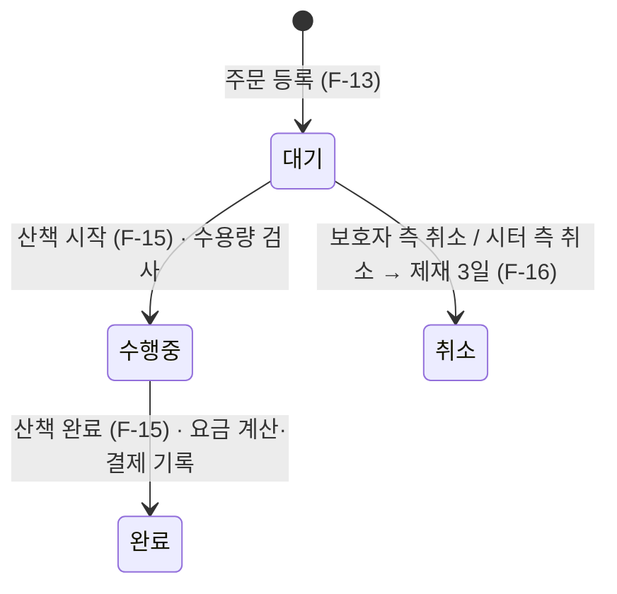

# 반려동물 산책 매칭 서비스 관리자 콘솔 — 요구사항 정의서 (v0.4)

콘솔 메뉴 입력을 MVC 구조와 JDBC로 MySQL에 반영하는 자바 실습 프로그램의 요구사항이다. 팀 v0.3과 석민 초안의 좋은 점을 합치고, 질의응답(Q1~Q15)에서 정한 사항을 반영했다. 하루 진행 기준이며, 메뉴 구조(9장)까지 포함한다.

---

## 1. 용어

| 용어 | 뜻 |
| --- | --- |
| 관리자 | 프로그램 사용자 1명. 로그인 없이 실행하면 바로 메인 메뉴 |
| 보호자 | 반려동물이 1마리 이상 등록된 회원 |
| 시터 | 시터 테이블에 등록된 회원. 개를 키우지 않는 시터, 보호자 겸 시터 모두 가능 |
| 회원번호 / 시터번호 | 서로 다른 번호. 회원 3번이 시터 1번일 수 있으므로 화면에서 항상 구분해 표기 |
| 요금방식 | 거리(km당 단가) 또는 시간(분당 단가). 주문 등록 때 정함 |
| 최대수용량 | 시터가 동시에 수행할 수 있는 산책 주문 수 (1~3, 주문 1건 = 반려동물 1마리) |
| 제재 | 시터 측 취소 시 일정 기간 새 주문 접수를 막는 것 |
| 결제 | 산책 완료 시 계산된 금액을 주문에 기록하는 것. 실제 결제(PG)는 하지 않음 |

## 2. 범위

4개 테이블의 CRUD와 주문 상태 처리만 만든다. 회원은 샘플 데이터와 회원 등록 기능으로 넣고, 기능마다 번호를 입력받아 DB에 있는지 확인한다.

| 구분 | 기능 | 비고 |
| --- | --- | --- |
| 포함 | 회원·반려동물·시터 등록·조회·수정·삭제 | 테이블별 CRUD |
| 포함 | 산책 주문 등록·조회, 상태 처리(시작·완료·취소) | 주문 테이블 CRUD |
| 포함 | 완료 시 요금 자동 계산과 결제 기록 | 실제 결제 없음 |
| 포함 | 시터 제재(자동)와 해제(수동) | |
| 포함 | 결제 통계 | 선택 기능 |
| 제외 | 회원가입·로그인 (관리자 포함) | |
| 제외 | 결제 연동, 파일 업로드, 이메일·문자 인증 | 콘솔·JDBC 범위 밖 |
| 제외 | GPS, 할증·할인 요금 | |
| 제외 | 로그인 메뉴 분리, 페이징 | 평가 보너스 항목, 이번에는 하지 않음 |

## 3. 기능 목록

필수 16개와 선택 1개다. 팀원마다 자기 테이블의 등록·조회·수정·삭제 4개를 맡고, 선택 기능 F-17은 분량이 가장 가벼운 A가 맡는다.

| ID | 대상 | 기능 | 설명 | 실습 포인트 | 우선순위 | 담당 |
| --- | --- | --- | --- | --- | --- | --- |
| F-01 | 회원 | 회원 등록 | 이름·연락처 입력, 연락처 중복 검사 | INSERT, 중복 확인 SELECT | 필수 | A |
| F-02 | 회원 | 회원 목록·검색 | 전체 목록, 이름 일부로 검색 | SELECT, LIKE | 필수 | A |
| F-03 | 회원 | 회원 수정 | 이름·연락처 수정 | UPDATE | 필수 | A |
| F-04 | 회원 | 회원 삭제 | 반려동물·시터 정보가 없는 회원만 | DELETE, 참조 확인 | 필수 | A |
| F-05 | 반려동물 | 반려동물 등록 | 보호자 회원번호 지정, 이름·견종·무게·활동지수 입력 | INSERT, FK 확인 | 필수 | B |
| F-06 | 반려동물 | 반려동물 목록 | 전체 또는 보호자별, 보호자 이름 함께 출력 | SELECT JOIN | 필수 | B |
| F-07 | 반려동물 | 반려동물 수정 | 이름·견종·무게·활동지수 수정 | UPDATE | 필수 | B |
| F-08 | 반려동물 | 반려동물 삭제 | 주문 이력이 없는 반려동물만 | DELETE, 참조 확인 | 필수 | B |
| F-09 | 시터 | 시터 등록 | 회원번호 지정, 단가·자격증·최대수용량 입력 (회원당 1개) | INSERT, UNIQUE 확인 | 필수 | C |
| F-10 | 시터 | 시터 목록 | 전체 또는 매칭 가능 시터, 이름 함께 출력 | SELECT JOIN, 날짜 비교 | 필수 | C |
| F-11 | 시터 | 시터 수정·제재 해제 | 단가·자격증·수용량 수정, 제재 즉시 해제 | UPDATE, NULL 처리 | 필수 | C |
| F-12 | 시터 | 시터 삭제 | 주문 이력이 없는 시터만 | DELETE, 참조 확인 | 필수 | C |
| F-13 | 주문 | 산책 주문 등록 | 반려동물·시터·산책일시·요금방식 입력, 대기 상태로 접수 | INSERT, 등록 전 검증, 날짜 변환 | 필수 | D |
| F-14 | 주문 | 주문 목록 | 전체·상태별·보호자별·시터별, 완료 주문 금액 합계 | 다중 JOIN, SUM | 필수 | D |
| F-15 | 주문 | 산책 시작·완료 | 시작 시 수용량 검사, 완료 시 요금 계산·결제 기록 | UPDATE, Service 규칙·계산 | 필수 | D |
| F-16 | 주문 | 주문 취소 | 취소 주체 선택, 시터 측 취소면 제재 | 트랜잭션 | 필수 | D |
| F-17 | 통계 | 결제 통계 | 시터별 수입·보호자별 지출 합계 | GROUP BY, ORDER BY | 선택 | A |

## 4. 기능 명세

예외는 두 종류로 표시한다. **[재입력]** 은 형식 오류라 그 항목만 다시 묻고, **[복귀]** 는 업무 규칙 위반이라 안내 후 해당 관리 메뉴로 돌아간다 (NFR-06, NFR-07).

### F-01 회원 등록 (A)

- **입력:** 이름, 연락처(010-0000-0000)
- **처리:** 형식 검사 → 연락처 중복 확인 → 저장 (가입일시 자동)
- **출력:** "회원이 등록되었습니다. (회원번호: N)"
- **예외:** [재입력] 빈 값, 연락처 형식 오류 / [복귀] 이미 등록된 연락처

### F-02 회원 목록·검색 (A)

- **입력:** 이름 검색어 (엔터만 누르면 전체)
- **처리:** `WHERE name LIKE ?` (`%검색어%`)
- **출력:** 회원번호·이름·연락처·가입일 표
- **예외:** 결과 없음 → "조회 결과가 없습니다."

### F-03 회원 수정 (A)

- **입력:** 회원번호, 새 이름·연락처 (엔터 시 기존 값 유지)
- **처리:** 회원 존재 확인 → 현재 값 출력 → 연락처 중복 확인(본인 제외) → UPDATE
- **출력:** "수정되었습니다."
- **예외:** [재입력] 연락처 형식 오류 / [복귀] 없는 회원번호, 다른 회원과 연락처 중복

### F-04 회원 삭제 (A)

- **입력:** 회원번호, 삭제 확인(Y/N)
- **처리:** 회원 존재 확인 → 반려동물·시터 정보가 없을 때만 DELETE
- **출력:** "삭제되었습니다."
- **예외:** [복귀] 없는 회원번호, "반려동물 또는 시터 정보가 있어 삭제할 수 없습니다."

### F-05 반려동물 등록 (B)

- **입력:** 보호자 회원번호, 이름, 견종, 무게(kg, 소수 첫째 자리까지), 활동지수(1~5)
- **처리:** 회원 존재 확인 → 범위 검사 → 저장
- **출력:** "등록되었습니다. (동물번호: N)"
- **예외:** [재입력] 무게 0 이하·숫자 아님·소수 둘째 자리 이상, 활동지수 범위 밖 / [복귀] 없는 회원번호

### F-06 반려동물 목록 (B)

- **입력:** 1.전체 2.보호자별(회원번호)
- **처리:** `pet JOIN member`로 보호자 이름 함께 조회
- **출력:** 동물번호·이름·견종·무게·활동지수·보호자 회원번호·보호자 이름 표
- **예외:** [복귀] 없는 회원이면 "존재하지 않는 회원번호입니다." / 회원은 있는데 반려동물이 없으면 "조회 결과가 없습니다."

### F-07 반려동물 수정 (B)

- **입력:** 동물번호, 바꿀 값 (엔터 시 기존 값 유지)
- **처리:** 존재 확인 → 현재 값 출력 → 범위 검사 → UPDATE (보호자는 바꾸지 않음)
- **출력:** "수정되었습니다."
- **예외:** [재입력] 범위 오류 / [복귀] 없는 동물번호

### F-08 반려동물 삭제 (B)

- **입력:** 동물번호, 삭제 확인(Y/N)
- **처리:** 존재 확인 → 주문 이력이 없을 때만 DELETE
- **출력:** "삭제되었습니다."
- **예외:** [복귀] 없는 동물번호, "산책 주문 이력이 있어 삭제할 수 없습니다."

### F-09 시터 등록 (C)

- **입력:** 회원번호, km당 단가, 분당 단가, 자격증(Y/N), 최대수용량(1~3)
- **처리:** 회원 존재 확인 → 이미 시터인지 확인 → 범위 검사 → 저장
- **출력:** "시터가 등록되었습니다. (시터번호: N)"
- **예외:** [재입력] 단가 0 이하, 자격증에 Y/N 외 입력, 수용량 범위 밖 / [복귀] 없는 회원번호, 이미 시터로 등록된 회원

### F-10 시터 목록 (C)

- **입력:** 1.전체 2.매칭 가능 시터만
- **처리:** `sitter JOIN member`. 매칭 가능 = `suspended_until IS NULL OR suspended_until <= NOW()`
- **출력:** 시터번호·회원번호·이름·km당 단가·분당 단가·자격증·수용량·제재종료일 표
- **예외:** 결과 없음

### F-11 시터 수정·제재 해제 (C)

- **입력:** 시터번호, 1.정보 수정(단가·자격증·수용량, 엔터 시 기존 값 유지) 2.제재 해제
- **처리:** 존재 확인 → 현재 값 출력 → 수정이면 범위 검사 후 UPDATE / 해제면 `suspended_until = NULL`. 수용량을 수행중 건수보다 낮게 바꿔도 허용 (BR-07)
- **출력:** "수정되었습니다." / "제재가 해제되었습니다."
- **예외:** [재입력] 범위 오류 / [복귀] 없는 시터번호, 제재 중이 아닌 시터를 해제하려 함

### F-12 시터 삭제 (C)

- **입력:** 시터번호, 삭제 확인(Y/N)
- **처리:** 존재 확인 → 주문 이력이 없을 때만 DELETE (회원 정보는 그대로 남음)
- **출력:** "삭제되었습니다."
- **예외:** [복귀] 없는 시터번호, "주문 이력이 있어 삭제할 수 없습니다."

### F-13 산책 주문 등록 (D)

- **입력:** 동물번호, 시터번호, 산책일시(yyyy-MM-dd HH:mm), 요금방식(1.거리 2.시간)
- **처리:**
  1. 반려동물·시터 존재 확인
  2. 시터가 제재 중이 아닌지 확인 (BR-03)
  3. 시터의 회원번호가 반려동물의 보호자 회원번호와 다른지 확인 (BR-03)
  4. 그 반려동물에 진행 중(대기·수행중) 주문이 없는지 확인 (BR-04)
  5. 산책일시가 현재 이후인지 확인 (BR-03)
  6. 요금방식에 맞는 시터의 현재 단가를 주문에 복사해 대기 상태로 저장 (BR-02)
- **출력:** "주문이 접수되었습니다. (주문번호: N)"
- **예외:** [재입력] 날짜 형식 오류, 요금방식 번호 오류 / [복귀] 1~5 중 걸린 조건을 안내

### F-14 주문 목록 (D)

- **입력:** 1.전체 2.상태별 3.보호자별(회원번호) 4.시터별(시터번호)
- **처리:** `walk_order JOIN pet JOIN member`, `JOIN sitter JOIN member`로 반려동물·보호자·시터 이름 함께 조회
- **출력:** 주문번호·산책일시·반려동물·보호자·시터·요금방식·상태·금액 표, 맨 아래 "완료 주문 합계: N원" (완료 주문이 없으면 0원)
- **예외:** [복귀] 없는 회원번호·시터번호 / 결과 없음

### F-15 산책 시작·완료 (D)

- **입력:** 주문번호, 1.시작 2.완료 / 완료 시 실측거리(km, 소수 둘째 자리까지)와 실측시간(분) 둘 다
- **처리:**
  - 시작: 대기 상태 확인 → 시터의 수행중 주문 수 < 최대수용량 확인 (BR-07) → 수행중. 산책일시와는 비교하지 않음 (BR-05)
  - 완료: 수행중 상태 확인 → 요금방식 쪽 실측값으로 요금 계산 (BR-01) → 실측값·금액·결제일시·완료 상태를 한 번에 UPDATE
- **출력:** "산책을 시작합니다." / "산책 완료. 결제 금액: 15,000원"
- **예외:** [재입력] 실측값 0 이하·숫자 아님·자릿수 초과 / [복귀] 없는 주문번호, 상태 순서 위반, 수용량 초과

### F-16 주문 취소 (D)

- **입력:** 주문번호, 취소 주체(1.보호자 2.시터), 확인(Y/N)
- **처리:** 대기 상태 확인 → 상태 '취소', 취소 주체 기록. 시터 측 취소면 시터 제재종료일 갱신 (BR-06). 두 UPDATE를 한 트랜잭션으로 처리 (NFR-05)
- **출력:** "취소되었습니다." / 시터 측 취소 시 "시터 OOO(시터번호 N)은 YYYY-MM-DD HH:mm까지 새 주문을 받을 수 없습니다."
- **예외:** [복귀] 없는 주문번호, 대기가 아닌 주문

### F-17 결제 통계 (A, 선택)

- **입력:** 1.시터별 수입 2.보호자별 지출
- **처리:** 완료 주문을 시터(또는 보호자)별로 `GROUP BY` → 건수·금액 합계, 합계 큰 순으로 정렬
- **출력:** 번호·이름·완료 건수·금액 합계 표
- **예외:** 결과 없음

## 5. 업무 규칙

아래 규칙은 모두 Service 계층에서 검사한다. 주문 상태는 대기 → 수행중 → 완료 세 단계이고, 취소는 대기에서만 된다.



| ID | 규칙 |
| --- | --- |
| BR-01 | 요금: 거리 = 실측거리(km) × km당 단가, 원 미만 버림 / 시간 = 실측시간(분) × 분당 단가. 계산에는 요금방식 쪽 실측값만 사용 |
| BR-02 | 주문 등록 시 요금방식에 맞는 시터의 현재 단가를 주문에 복사. 이후 시터 단가가 바뀌어도 기존 주문은 그대로 |
| BR-03 | 주문 조건: 산책일시가 현재 이후, 시터가 제재 중 아님, 시터의 회원번호 ≠ 반려동물의 보호자 회원번호. 제재 검사는 등록 시점에만 하며, 이미 접수된 대기 주문은 제재 후에도 시작 가능 |
| BR-04 | 한 반려동물에 진행 중(대기·수행중) 주문은 1건만 |
| BR-05 | 상태는 대기 → 수행중 → 완료 순서로만. 취소는 대기에서만 가능하고 수행중·완료 주문은 취소 불가. 시작 시점은 산책일시와 비교하지 않음 (보호자·시터 협의 사항) |
| BR-06 | 시터 측 취소 시 제재종료일 = 현재 + 3일. 기존 제재종료일이 더 늦으면 그대로 유지. 보호자 측 취소는 제재 없음. 취소 주체는 주문에 기록 |
| BR-07 | 시터의 수행중 주문 수가 최대수용량보다 작을 때만 산책 시작 가능. 수용량을 수행중 건수보다 낮게 수정해도 허용하고 다음 시작부터 적용 |
| BR-08 | 결제금액·결제일시는 완료 상태에서만, 취소 주체는 취소 상태에서만 값이 있고 나머지는 NULL |
| BR-09 | 제재 해제 = 제재종료일을 NULL로. 제재 중이 아닌 시터는 해제 대상이 아님 |
| BR-10 | 다른 데이터가 참조하는 회원·반려동물·시터는 삭제 불가 (이력 보존). 주문 이력이 있는 회원은 결과적으로 삭제할 수 없음 |
| BR-11 | 회원 연락처는 중복 불가. 수정 시에는 본인 연락처를 제외하고 검사 |

## 6. 비기능 요구사항

잘못된 입력에도 프로그램이 종료되지 않아야 하고, 4명이 만든 화면이 같은 입력 방식과 출력 형식을 따라야 한다.

| ID | 항목 | 기준 |
| --- | --- | --- |
| NFR-01 | 환경 | JDK 21, MySQL 8.0, MySQL Connector/J, 콘솔(Scanner) 입출력 |
| NFR-02 | 구조 | InputView·OutputView는 입출력만, Controller는 흐름, Service는 규칙 검사, DAO는 SQL만. MainController는 메뉴 분기만 |
| NFR-03 | SQL 안전성 | 모든 쿼리는 PreparedStatement, 문자열 이어붙이기 금지 |
| NFR-04 | 자원 관리 | Connection·PreparedStatement·ResultSet은 try-with-resources로 닫기 |
| NFR-05 | 트랜잭션 | F-16 시터 측 취소(주문 UPDATE + 시터 제재 UPDATE)는 하나의 Connection에서 setAutoCommit(false) → commit(), 실패 시 rollback() |
| NFR-06 | 형식 오류 입력 | 숫자 자리에 문자, 날짜·연락처 형식 오류, 범위 밖 값, 빈 값 → 안내 후 그 항목만 다시 입력 (공통 InputUtil) |
| NFR-07 | 업무 규칙 위반 | 없는 번호, 제재 중, 상태 순서 위반, 중복, 삭제 불가 등 → 어떤 조건에 걸렸는지 안내 후 해당 관리 메뉴로 복귀 |
| NFR-08 | 출력 형식 | 공통 OutputUtil 사용. 금액은 천 단위 콤마 + 원(15,000원), 날짜는 yyyy-MM-dd HH:mm, 목록은 열을 맞춘 표, 결과 없으면 "조회 결과가 없습니다." |
| NFR-09 | 번호 표기 | 입력 안내와 표 열 이름에 회원번호·시터번호·동물번호·주문번호를 항상 구분해 표기 |
| NFR-10 | DB 오류 | 연결 실패나 예상하지 못한 SQL 오류는 "데이터 처리 중 오류가 발생했습니다." 출력 후 메인 메뉴로 복귀 |
| NFR-11 | 설정 분리 | DB 접속 정보는 db.properties로 분리해 .gitignore에 등록하고, db.properties.example만 커밋 |
| NFR-12 | 데이터 제약 | NOT NULL, CHECK, FK(RESTRICT), UNIQUE, ENUM으로 DB에서도 한 번 더 막기. 문자셋은 utf8mb4 |

## 7. 데이터 요구사항

테이블은 4개, 1:N 관계는 3개다. 상태·요금방식·취소 주체는 한글 값 ENUM으로 두어 샘플 데이터를 읽히는 그대로 넣고, 오타는 DB가 거부하게 한다.

| 테이블 | 컬럼 |
| --- | --- |
| `member` | member_id(PK, AI), name, phone(UNIQUE, 010-0000-0000), created_at |
| `pet` | pet_id(PK, AI), member_id(FK→member), name, breed, weight(DECIMAL(4,1), CHECK > 0), activity_level(CHECK 1~5) |
| `sitter` | sitter_id(PK, AI), member_id(FK→member, UNIQUE), price_per_km, price_per_min(둘 다 CHECK > 0), certified(BOOLEAN), max_capacity(CHECK 1~3), suspended_until(NULL 허용) |
| `walk_order` | order_id(PK, AI), pet_id(FK→pet), sitter_id(FK→sitter), walk_at, fee_type(ENUM '거리','시간'), applied_price, status(ENUM '대기','수행중','완료','취소', 기본 '대기'), canceled_by(ENUM '보호자','시터', NULL 허용), distance_km(DECIMAL(5,2)), duration_min, amount, paid_at, created_at |

| 관계 | 카디널리티 |
| --- | --- |
| member – pet | 1 : N |
| member – sitter | 1 : 0..1 (member_id UNIQUE로 회원당 시터 1개) |
| pet – walk_order | 1 : N |
| sitter – walk_order | 1 : N |

- **한글 ENUM:** sample-data.sql에 `'완료'`, `'시터'`처럼 그대로 쓰고, Java는 enum 매핑 없이 같은 문자열을 공통 상수 클래스에 둔다. DB와 접속 URL 문자셋은 utf8mb4로 맞춘다.
- **소수 자리:** 무게는 소수 첫째 자리(4.5kg), 실측거리는 소수 둘째 자리(3.25km)까지.
- **보호자 번호 없음:** 주문에는 보호자 번호를 따로 두지 않는다. 반려동물로 보호자를 알 수 있어 중복 저장(3NF 위반)이 되기 때문이다.
- **시터 PK:** 회원번호와 같게 쓰지 않고 별도 AUTO_INCREMENT로 둔다 (과제 규칙). 그래서 회원번호와 시터번호는 다른 값이다.
- **FK:** 모두 기본값(RESTRICT)으로 두어 BR-10이 DB에서도 지켜진다.
- **샘플 단가:** km당 3,000~5,000원, 분당 200~300원. 원 보고서의 분당 8,000원은 1시간에 48만 원이 되므로 쓰지 않는다.

## 8. 담당 배분과 공통 작업

D는 자기 기능 4개만 맡고, 공통 작업과 D가 쓰는 검증용 조회·계산은 A·B·C가 나눠 만든다. B와 C는 이미 삭제 확인(F-08, F-12)에서 주문 수를 세는 쿼리를 쓰므로, 그 쿼리를 조금 넓혀 D에게 제공한다.

| 담당 | 테이블 | 기능 | 공통·지원 작업 | 다른 팀원에게 제공하는 메서드 |
| --- | --- | --- | --- | --- |
| A | member | F-01~04, F-17 | Main, MainController, DBUtil, db.properties.example | 회원 존재 확인 (F-05, F-06, F-09, F-14) |
| B | pet | F-05~08 | InputUtil(정수·실수·Y/N·날짜·연락처 입력), OutputUtil(금액·날짜 포맷, 표 출력), sample-data.sql | 반려동물 1마리 조회(보호자 회원번호 포함), 진행 중 주문 존재 여부, 회원의 반려동물 수 |
| C | sitter | F-09~12 | schema.sql, 상수 클래스(상태·요금방식·취소 주체), FeeCalculator(BR-01) | 시터 1명 조회(단가·제재일·회원번호), 제재 중 여부, 수행중 주문 수, 회원의 시터 여부, 제재종료일 변경(Connection 매개변수) |
| D | walk_order | F-13~16 | 없음 | 없음 (B·C의 메서드를 사용) |

**공통 작업 순서:** schema.sql과 DBUtil이 먼저 develop에 들어가야 나머지가 시작할 수 있다. 메서드 이름과 매개변수는 공통 작업 때 정한다.

**sample-data.sql 기준:**

- 회원 8명 이상: 보호자만, 시터만, 보호자 겸 시터를 섞는다
- 제재 중 시터 1명: `suspended_until = NOW() + INTERVAL 3 DAY`로 넣어 발표 날에도 제재 중이게 한다
- 주문은 대기·수행중·완료·취소 상태를 1건 이상씩 넣는다. 샘플 주문의 산책일시는 과거여도 된다 (BR-03은 F-13으로 등록할 때만 검사)

## 9. 메뉴 구조

메인 메뉴 5개, 관리 메뉴마다 기능 4개이고, 기능 명세의 하위 선택지까지 3단계로 고정한다. 하위 선택지 번호는 아래와 같이 모두 통일한다.

```text
[메인 메뉴]                       MainController (분기만)
1. 회원 관리         → A
2. 반려동물 관리     → B
3. 시터 관리         → C
4. 주문·결제 관리    → D
5. 결제 통계 (선택)  → A
0. 종료

[1. 회원 관리]
1. 등록 (F-01)
2. 목록·검색 (F-02)      검색어 입력, 엔터만 누르면 전체
3. 수정 (F-03)           회원번호 → 현재 값 출력 → 새 값 (엔터 시 유지)
4. 삭제 (F-04)           회원번호 → 확인(Y/N)
0. 뒤로

[2. 반려동물 관리]
1. 등록 (F-05)
2. 목록 (F-06)           1) 전체  2) 보호자별(회원번호)
3. 수정 (F-07)           동물번호 → 현재 값 출력 → 새 값 (엔터 시 유지)
4. 삭제 (F-08)           동물번호 → 확인(Y/N)
0. 뒤로

[3. 시터 관리]
1. 등록 (F-09)
2. 목록 (F-10)           1) 전체  2) 매칭 가능 시터만
3. 수정·제재 해제 (F-11) 시터번호 → 1) 정보 수정  2) 제재 해제
4. 삭제 (F-12)           시터번호 → 확인(Y/N)
0. 뒤로

[4. 주문·결제 관리]
1. 주문 등록 (F-13)
2. 주문 목록 (F-14)      1) 전체  2) 상태별(대기·수행중·완료·취소)  3) 보호자별(회원번호)  4) 시터별(시터번호)
3. 산책 시작·완료 (F-15) 주문번호 → 1) 시작  2) 완료(실측거리·실측시간 입력)
4. 주문 취소 (F-16)      주문번호 → 취소 주체 1) 보호자  2) 시터 → 확인(Y/N)
0. 뒤로

[5. 결제 통계]
1. 시터별 수입 (F-17)
2. 보호자별 지출 (F-17)
0. 뒤로
```

**이동 규칙:**

- 형식 오류는 그 자리에서 다시 입력받는다 (NFR-06).
- 기능을 마쳤거나 업무 규칙 위반으로 막히면 해당 관리 메뉴로 돌아간다 (NFR-07).
- DB 오류가 나면 메인 메뉴로 돌아간다 (NFR-10).

## 10. v0.4에서 정한 것

팀 v0.3, 석민 초안, 질의응답(Q1~Q15)에서 가져온 결정을 한곳에 모았다.

| 항목 | 결정 | 출처 | 반영 위치 |
| --- | --- | --- | --- |
| 테이블 구성 | 4개, 결제는 주문 테이블에 포함 | v0.3 | 7장 |
| 주문 상태 | 대기 → 수행중 → 완료, 취소는 대기에서만 | v0.3 | BR-05 |
| 기능 표기 | 실습 포인트 열 추가 | 석민 초안 | 3장 |
| 잘못된 입력 | 형식 오류는 그 항목 재입력, 규칙 위반은 안내 후 메뉴 복귀 | Q1 | NFR-06, NFR-07 |
| 공통 입출력 | InputUtil·OutputUtil을 공통 작업으로 | Q2 | NFR-06, NFR-08, 8장 |
| 코드값 저장 | 한글 값 ENUM | Q3 | 7장 |
| 완료 입력 | 실측거리·실측시간 둘 다 필수, 계산은 요금방식 쪽만 | Q4 | F-15, BR-01 |
| 소수 자리 | 무게 첫째 자리, 거리 둘째 자리 | Q5 | 7장, F-05, F-15 |
| 재제재 | 기존 제재종료일이 더 늦으면 유지 | Q6 | BR-06 |
| 제재 효과 | 새 주문 접수만 막고, 기존 대기 주문은 시작 가능 | Q7 | BR-03 |
| 수용량 축소 | 허용, 다음 시작부터 적용 | Q8 | BR-07, F-11 |
| 시작 시점 | 산책일시와 비교하지 않음 (협의 사항) | Q9 | BR-05, F-15 |
| 수행중 취소 | 불가 | Q10 | BR-05 |
| 번호 표기 | 회원번호·시터번호 등 항상 구분 | Q11 | NFR-09, F-10 |
| 샘플 제재일 | NOW() + INTERVAL 3 DAY | Q12 | 8장 |
| 보호자별 조회 메시지 | 없는 회원과 반려동물 없음을 구분 | Q13 | F-06 |
| 합계 0건 | "완료 주문 합계: 0원" 출력 | Q14 | F-14 |
| 분량 | D는 기능 4개만, 공통·지원 작업은 A·B·C, F-17은 A | Q15 | 8장 |
